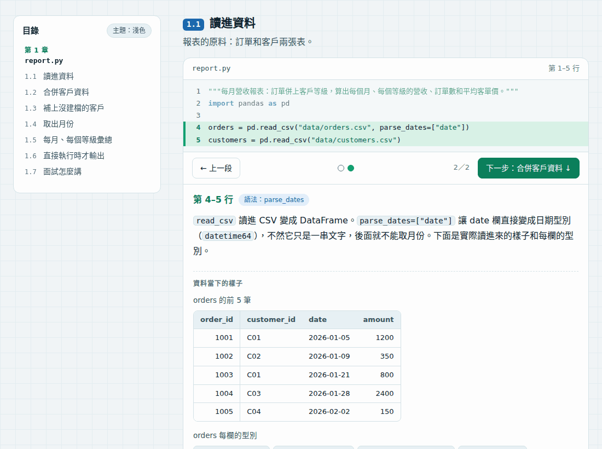
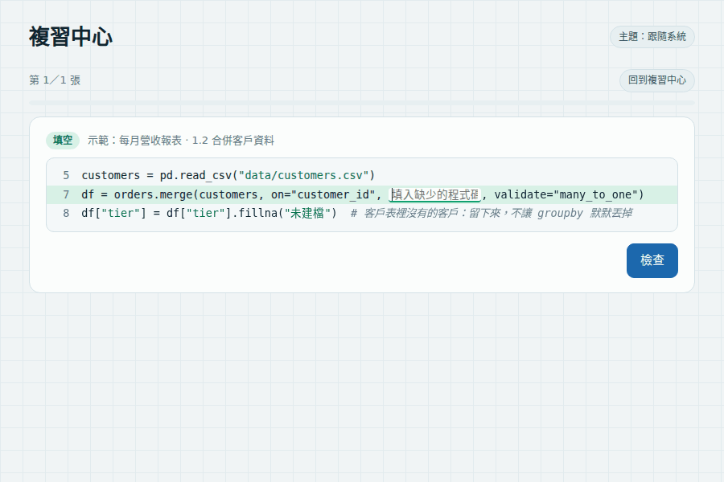
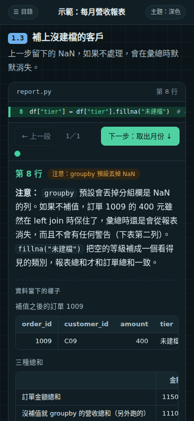
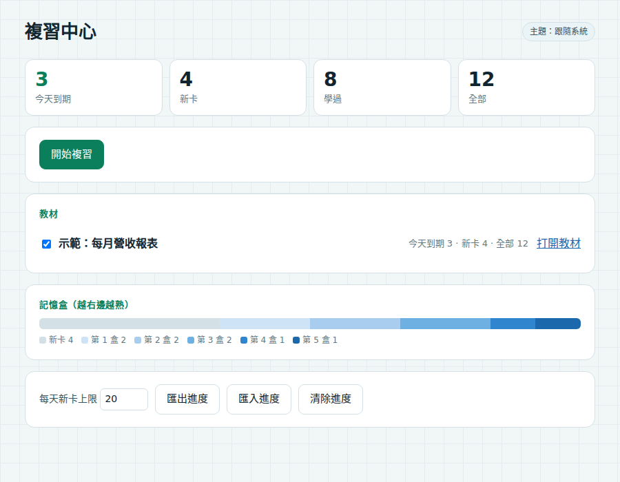

# code-walkthrough

一個 [Claude Code](https://claude.com/claude-code) skill：把**你自己的程式**做成逐行講解的互動教材，再用填空題、選擇題和間隔重複複習，讓你真的記住。資料分析、後端、前端、系統架構都適用。

> **English summary.** A Claude Code skill that turns code you own into an evidence-grounded, line-by-line walkthrough (every step shows what the data, output or screen actually looked like when that code ran), audits and fixes the code before teaching it, and generates fill-in-the-blank review cards for a spaced-repetition review hub. UI in Traditional Chinese or English.

## 為什麼要做這個

讀懂別人的教學很容易，講清楚自己的專案很難。面試時被問「這段為什麼這樣寫」「這個數字怎麼來的」，需要的是對**自己程式**的理解，而不是一般知識。

這個 skill 的三個原則：

- **證據（evidence）**：教材上的每張表、每個數字、每張截圖，都是實際執行程式取得的，不是憑印象寫的。
- **錨點（anchor）**：教材裡的位置一律用程式片段定位（例如 `"df = pd.read_csv"`），不手寫行號。程式改了，行號自動跟上；片段不見了會直接報錯，不會默默講錯行。
- **先審查再教（audit first）**：寫教材前先執行、審查程式，把 bug 和不一致修好、加上測試，教的是正確的版本；修改前錯在哪，變成教材裡的「注意」段落和面試素材。

## 會產出什麼

1. **逐行講解頁**（單一 HTML，淺色／深色、手機都能看）：上面是程式，按「下一段」標出正在講的幾行，下面是白話說明和那一刻資料的樣子；每章最後是「面試時可以怎麼講」。
2. **複習卡**：從真實程式挖空的填空題、觀念選擇題、需要自己組織答案的回想卡；面試題也自動變成回想卡。
3. **複習中心**（`~/learning/hub/index.html`）：所有專案的卡片放在一起，用 Leitner 記憶盒排程（1、3、7、16、35 天），進度存在瀏覽器，可以匯出備份。

## 示範

[`examples/sales`](examples/sales) 是一支 18 行的 pandas 報表程式（虛構的 12 筆訂單），用這個 skill 產生的教材長這樣：



複習中心：填空題挖的是真實程式碼，答完會說明理由、連回講解；選擇題的選項會洗牌。



| 手機、深色模式 | 複習中心首頁 |
|---|---|
|  |  |

自己產生一次（不會動到你的 `~/learning`）：

```bash
uv run --with pygments --with pandas --with pillow python examples/make_readme_images.py
```

## 安裝

```bash
git clone https://github.com/hcy1041116/code-walkthrough.git
cd code-walkthrough
./install.sh          # 連結到 ~/.claude/skills/walkthrough，並建立 ~/learning/
```

然後填寫 `~/learning/PROFILE.md`：你熟悉什麼、不熟什麼、教材用什麼語言。skill 會依這份設定調整講解方式（例如懂統計的人，AUC 會用 Mann-Whitney U 來解釋）。

## 使用

在 Claude Code 裡直接說：

> 幫我把 `train.py` 和 `api/` 做成逐行講解教材

Claude 會照 [`skills/walkthrough/SKILL.md`](skills/walkthrough/SKILL.md) 的流程走：確認範圍 → 審查並修正程式 → 擷取證據 → 寫說明和複習卡 → 產生頁面並自我檢查 → 交付。程式之後有改，再說一次「更新教材」即可。

引擎也可以直接用（用專案自己的 Python 執行）：

```bash
WT=~/.claude/skills/walkthrough/engine/run.py
python $WT new docs/walkthrough_tools      # 建立工具資料夾
python $WT capture docs/walkthrough_tools  # 執行擷取腳本
python $WT render docs/walkthrough_tools   # 產生頁面、複習卡，更新複習中心
python $WT verify docs/walkthrough_tools   # 自我檢查
```

## 自我檢查做了什麼

`verify` 會確認：頁面上每一行程式和原始檔逐字相同；頁面的腳本能正常解析，「第 X–Y 行」由頁面自己的 JavaScript 產生後和 Python 端一致；說明裡沒有手寫行號；說明引用的程式碼都出現在標示的那幾行；填空題的答案就在那一行的那個位置；選擇題的選項長度不會洩漏答案。

## 結構

```
skills/walkthrough/
  SKILL.md                 給 Claude 的流程（每一步都有完成條件）
  references/              內容規格、複習卡規則、各領域的取證方法（data / backend / frontend / architecture）
  engine/run.py            命令列
  engine/wt/               錨點、擷取、語法上色、產生頁面、自我檢查、複習中心
  templates/learning/      ~/learning 的 PROFILE.md、GLOSSARY.md 範本
tests/                     引擎測試（附一個迷你示範專案）
examples/sales/            README 示範用的報表程式和它的教材設定（虛構資料）
```

需要 Python 3.10 以上。選用：Pygments（任何語言的語法上色，沒裝時 Python 檔用內建分析）、Node.js（自我檢查時比對頁面上的 JavaScript）、無頭瀏覽器（截圖）。

```bash
uv run --with pytest python -m pytest -q    # 測試
```

## 文件

- [PRD](docs/PRD.md)：要解決的問題、不做什麼、成功標準、改版歷程
- [ADR](docs/adr/)：重要設計決定和理由（為什麼用錨點、為什麼先修程式再教⋯）

## 授權

MIT
